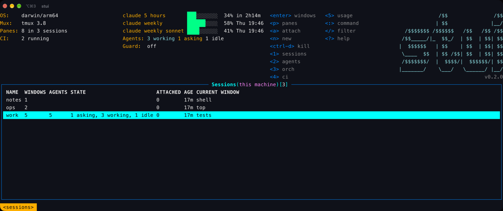
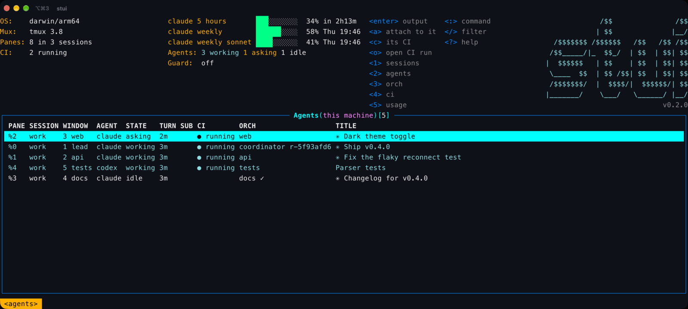
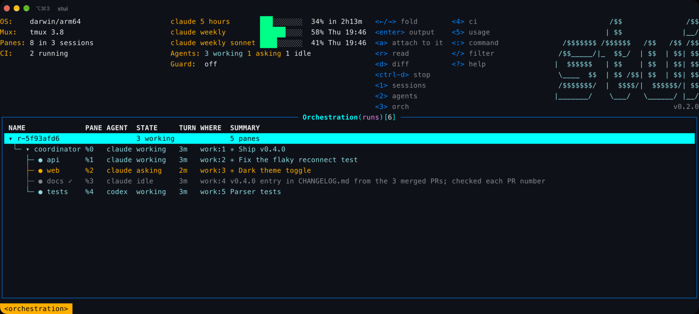
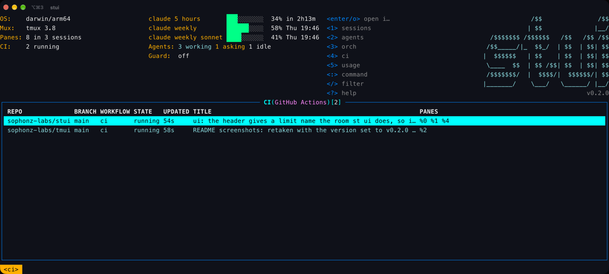
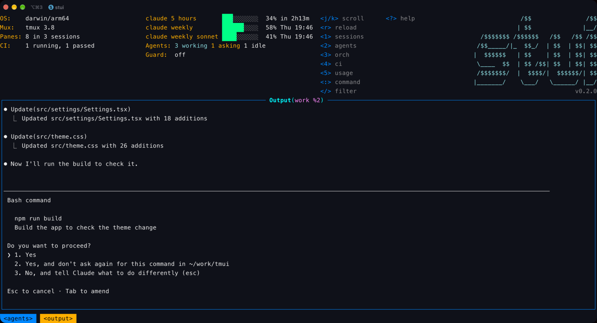

# stui

```text
             /$$               /$$
            | $$              |__/
  /$$$$$$$ /$$$$$$   /$$   /$$ /$$
 /$$_____/|_  $$_/  | $$  | $$| $$
|  $$$$$$   | $$    | $$  | $$| $$
 \____  $$  | $$ /$$| $$  | $$| $$
 /$$$$$$$/  |  $$$$/|  $$$$$$/| $$
|_______/    \___/   \______/ |__/
```

A terminal UI for tmux and the coding agents running in it. It shows your sessions, windows and panes, which Claude Code, Codex, opencode or Pi agents are idle, working or asking for you, the GitHub Actions state of each pane's repository, and the orchestration runs where one agent hands work to others. It attaches to any of them and comes back when you detach.

Everything stays on this machine. stui runs a small background server on `127.0.0.1` that watches tmux and the agents' hooks; the UI and the CLI talk to it. It makes two kinds of network call: `gh` asks GitHub for CI runs, and the usage poller asks Anthropic and OpenAI for your plan limits (see [Usage limits](#usage-limits); `stui usage poll off` stops it).

## Screenshots

The sessions, with the agents in each and their plan limits at the top:



The agents: which are working, which are asking, and their repository's CI:



An orchestration run: a coordinator and the workers it handed parts to:



GitHub Actions for the repositories the panes are in:



An agent's pane, waiting on a permission prompt:



Text captures of each screen are in [docs/captures](docs/captures).

## Without st / with st

stui needs no st, no account and no relay: install it, run `stui`, and everything above works on this machine alone. The two keep separate state (`~/.stui` here, `~/.sophonz` for st).

When st runs on the same machine, stui shows st's runs and agents too, **read-only**: it asks st's local server (the address and token in `~/.sophonz/agent.json`, on 127.0.0.1 only, GET only) at every refresh. st's runs are marked `(st)` in the orchestration tree and the agents' ORCH column. A pane both see (the same tmux pane) is listed once, with st's record, since st knows the run it is in.

- Reading works on st's rows: `enter` (output), `a` (attach), `c` and `o` (CI), `y` (copy), and `r` and `d`, which run st's own `st worker read` and `st worker diff`.
- Changing does not: `ctrl-d` on one of st's workers says `this is st's run: use st ui`. A run belongs to the tool whose coordinator started it.
- When st's server is not running, or does not answer within a second, stui shows only its own.
- `st.read: false` in config.yaml turns it off. `STUI_ST_HOME` points at another st state directory (default `$SOPHONZ_HOME`, else `~/.sophonz`).

Other machines stay `st ui`'s: stui is this machine only.

## Install

```sh
curl -fsSL https://dl.sophonz.io/stui/install.sh | sh
```

It puts `stui` in `~/.local/bin` after checking its SHA-256 (`STUI_INSTALL_DIR` puts it elsewhere, `STUI_VERSION=v0.1.0` pins a release). `stui upgrade` replaces it with the latest release the same way and restarts the background server on it (`--check` only says whether there is one, `--version vX.Y.Z` installs that one). With Go:

```sh
go install github.com/sophonz-labs/stui@latest
```

Or download `stui-<os>-<arch>.tar.gz` (macOS and Linux, amd64 and arm64) and `checksums.txt` from the releases page.

Then let the agents report their turns to stui:

```sh
stui hooks install          # Claude Code, Codex, opencode, Pi and others it finds
stui hooks status
```

Without hooks stui still reads the agents' screens, but hooks are what tell working from asking reliably.

## Usage

```sh
stui                  # the UI; starts the background server if needed
stui ui agents        # open on a view: sessions, agents, orch, ci, usage
stui status           # the server and every agent's hooks
stui stop             # stop the server
stui --help
```

`enter` goes down a level (sessions, windows, panes, a pane's output), `esc` comes back. `?` lists every key.

## Keys

| Key | Where | Does |
|---|---|---|
| `1`-`5` | everywhere | sessions, agents, orch, ci, usage |
| `j` `k` `↑` `↓`, `g` `G`, `ctrl-b` `ctrl-f` | everywhere | move, top and bottom, a page |
| `enter` | lists | into the row; in the CI view, open the run |
| `esc`, `q` | everywhere | back (or clear the filter); `q` quits at the top |
| `/` | lists | filter the rows |
| `a` | sessions, windows, panes, agents, orch | attach (see below) |
| `c` | panes, agents | that pane's CI runs |
| `o` | panes, agents, CI | open the CI run in the browser |
| `n` | sessions, windows | new session; new window, optionally with an agent |
| `ctrl-d` | sessions, windows, orch | kill or stop (asks first) |
| `r` `d` | orch | read a worker's answer, its diff |
| `:` | everywhere | a view, `:ext`, `:config`, or any stui command: `:worker list`, `:orch history` |
| `ctrl-r` | everywhere | refresh now, and read config.yaml again (it refreshes every 2 seconds, CI every fifth time) |
| `ctrl-e` | everywhere | the header on and off |
| `y` | lists | copy the row's value: a session's name, `session:index` for a window, a pane's id, a run's name, a CI run's URL, a plugin row's `url` (else its id) |
| `Y` | lists | copy the whole row, tab-separated |
| `v` | output | select lines, from the bottom one on screen; `j` `k` `g` `G` extend the selection |
| `y` | output | copy the selection, or with none the whole output (every line, not only those on screen) |
| `z` | output | the output alone on the screen, no frame, for your terminal's own mouse selection; `esc` comes back |

States: `working` is teal, `asking` (the agent waits for a person) is orange, `idle` and `done` are plain. A state the program reported itself (OSC 7501) is marked `(reported)`, e.g. `asking (reported)`; the others come from hooks or the screen.

### Copying

The screen belongs to stui, so a mouse selection takes the frame and the columns with it. `y`, `Y` and `v` copy only the content, as plain text (no colours, no trailing spaces). The text goes out two ways at once:

- **The terminal's clipboard.** Outside tmux, stui writes OSC 52, which also crosses ssh (iTerm2, kitty, WezTerm, Alacritty, Windows Terminal and foot take it; some need it allowed). Inside tmux, an application's OSC 52 only gets through with `set-clipboard on`, so stui hands the text to `tmux load-buffer -w` instead: it becomes a tmux paste buffer (`prefix ]`), and tmux sends it on to the terminal unless `set-clipboard` is `off`.
- **This machine's clipboard,** when it has a tool for it: `pbcopy` on macOS, `wl-copy` on Wayland, `xclip` on X11, `clip.exe` in WSL.

## Attach and come back

Before attaching, stui says how to get back, with your real prefix key.

- Outside tmux, stui runs `tmux attach`. Detach (`prefix d`) and stui is back.
- Inside tmux 3.2 or later, it opens the session in a full-size `display-popup`. `prefix d` detaches the popup's client, the popup closes, and stui is where it was.
- Attaching to the session stui itself runs in switches to that window; `prefix l` returns.
- Inside tmux older than 3.2 it uses `switch-client`; `prefix L` or `prefix s` returns.

Attaching to a pane selects its window and the pane first.

## CI

For every pane, stui finds the git checkout it is in, the GitHub repository of its remote and the branch checked out, and asks `gh run list` for its runs (each repository at most every 5 seconds). The CI column and the CI view show each workflow's latest run on that branch: `● running`, `✓ passed`, `✗ failed`. `o` opens the run that matters most (a failed one, else a running one) with `open` on macOS or `xdg-open` on Linux.

stui never sees a GitHub token: `gh` holds it. Run `gh auth login` once. From the command line:

```sh
stui ci                   # this commit's runs
stui ci log --failed      # the failed job's log
```

## Orchestration

One agent (the coordinator) starts other agents as workers in their own tmux windows, hands them tasks, waits, and reads their reports. The commands are for the agents; `stui plugin install` teaches Claude Code and Codex to use them.

```sh
stui orch start --objective "make the parser tests pass"
stui worker start --agent claude --name tests --task task.md
stui worker wait --check-in 3m
stui worker read tests
stui worker send tests --file followup.md
stui worker list
```

A worker reports with `stui worker done --summary "<what it did, how it checked>"`. Workers can get their own git worktree (`--worktree`), owned paths (`--owns`), tasks with dependencies (`stui task`), and decisions that need a person (`stui gate`). See [docs/orchestration.md](docs/orchestration.md) and [docs/captures/orchestration.txt](docs/captures/orchestration.txt).

## Usage limits

The usage view and the header show how much of each plan limit Claude Code and Codex have used, and when it resets. stui gets the numbers two ways, and shows the newer:

- **It asks the provider.** Every five minutes the running stui reads the login the CLI already keeps on this machine (Claude Code: the macOS keychain item `Claude Code-credentials`, or `~/.claude/.credentials.json`; codex: `~/.codex/auth.json`) and makes the same request that CLI's own `/usage` makes: `GET https://api.anthropic.com/api/oauth/usage` and `GET https://chatgpt.com/backend-api/wham/usage`. The token is sent only to its own provider, never written anywhere, never logged and never refreshed; an expired one is skipped until the CLI signs in again. What comes back (percentages and reset times) is kept in `~/.stui/usage`.
- **The agent hands it over.** `stui hooks install --usage` makes `stui statusline` Claude Code's status line, which receives the limits on every turn; Codex writes them into its session files.

```sh
stui usage              # the limits, from the command line
stui usage poll off     # stop asking the providers; only what the agents hand over is shown
stui usage poll on
```

An API-key login has no plan limits, so there is nothing to show for it.

## Plugins

A plugin brings another CLI in: its output as a view in stui's table, and its commands on keys and on the `:` line. Plugins are JSON files; the format and the examples are in [tui-plugins](https://github.com/sophonz-labs/tui-plugins), whose [SPEC.md](https://github.com/sophonz-labs/tui-plugins/blob/main/SPEC.md) is the full reference. tmui reads the same files.

```sh
stui ext install gh-prs       # from tui-plugins; prints every command it will run and asks first
stui ext install ./my-plugin  # a directory with a plugin.json, or a path or URL to one
stui ext list
stui ext remove gh-prs
```

They live in `~/.config/stui/plugins/<name>/plugin.json` (or under `$XDG_CONFIG_HOME`); stui also reads `~/.config/tui-plugins/`, which it shares with tmui. With `gh-prs` installed, put the cursor on a pane (or an agent) in a GitHub repository and press `P` (or type `:prs`): its pull requests open as a table, and `o` opens the one under the cursor in the browser.

- A view runs a command (as argv, no shell) and reads its output as `json`, `tsv` or `lines`. `refresh` runs it again on a timer; a failure shows in the view.
- An action is a key on rows of plugin views or of the `sessions`, `windows` and `panes` views; a `panes` key works on the agents view too. `{field}` is a field of the row, `{session}` `{window}` `{pane}` `{pane_cwd}` `{pane_command}` the tmux row's. A placeholder fills one argument and never splits it.
- `mode` is `background` (the last line of output goes to the status line), `foreground` (the command gets the terminal), or `popup` (a tmux popup over stui, inside tmux 3.2 or later). `confirm` asks first.
- A command is `:name [args]`, with `{args}`.
- stui's own keys, views and commands always win. A plugin key that meets one is left out, and `:ext` says so.

`stui ext` is for the UI; `stui plugin` is something else (the orchestration skills for coding agents).

## Config

Settings live in `~/.config/stui/config.yaml` (or under `$XDG_CONFIG_HOME`), as k9s keeps its own. Without the file stui uses the defaults. A key it does not know, or a value it cannot use, is a warning in the status line and in `:config`, and the default stands. stui reads the file again when it changes, and on `ctrl-r`.

```sh
stui config          # the settings in effect, and where each comes from
stui config edit     # open it in $EDITOR, made with every default commented if missing
stui config path
```

| Key | Default | |
|---|---|---|
| `ui.logo` | `true` | the logo at the header's top right; `:logo` turns it off for now |
| `ui.headless` | `false` | no header at all; `ctrl-e` or `:headless` toggles it for now |
| `ui.color` | `true` | `false` draws without colour, as `NO_COLOR` (which always wins) |
| `refreshRate` | `2s` | how often stui reads its server again, `500ms` or more; CI every fifth time |
| `startView` | `sessions` | the view it opens on: `sessions`, `agents`, `orch`, `ci` or `usage` (`stui ui <view>` still wins) |
| `plugins.enabled` | `true` | `false` loads no plugins |
| `plugins.disabled` | `[]` | plugins to leave out, by name |
| `st.read` | `true` | when st runs on this machine, show its runs and agents too, read-only |

[config.example.yaml](config.example.yaml) has them all. The logo needs 20 rows and the room the header's keys leave: 162 columns on the sessions, agents and orch views, 144 on ci and usage. Narrower, the header ends in a one-row `stui` and the version.

## Files

stui keeps its state in `~/.stui` (`STUI_HOME` moves it): the server's address and token, the runs, briefs and inboxes, and the server's log. `stui hooks install` edits the agents' own settings files and keeps a backup next to each.

## Requirements

- tmux 3.0 or later on `PATH`. Attaching in a popup needs 3.2.
- macOS or Linux.
- `gh` for CI (optional).
- `git` for worktrees (optional).

## License

Apache-2.0. See [LICENSE](LICENSE).
